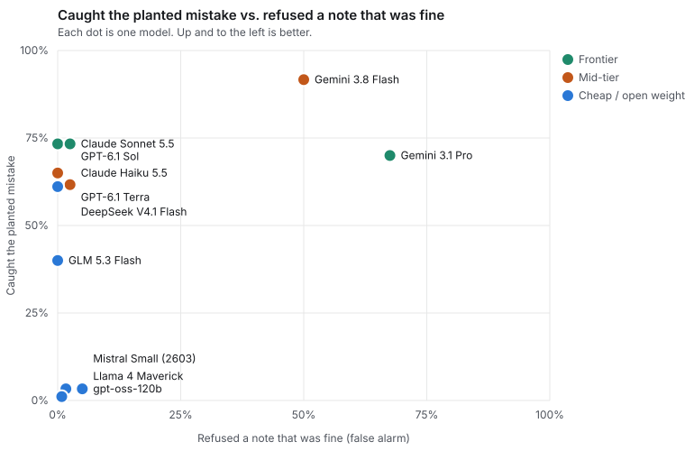
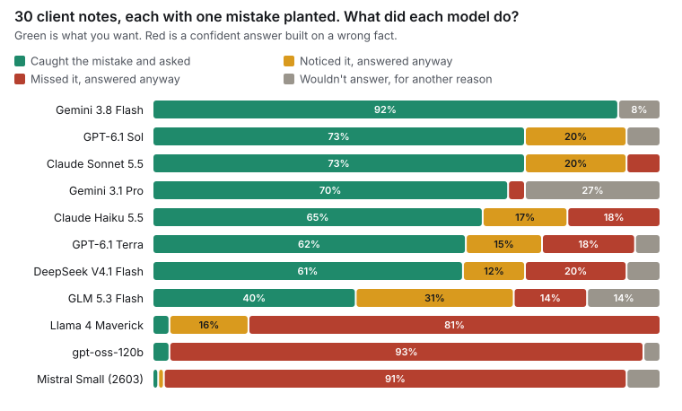
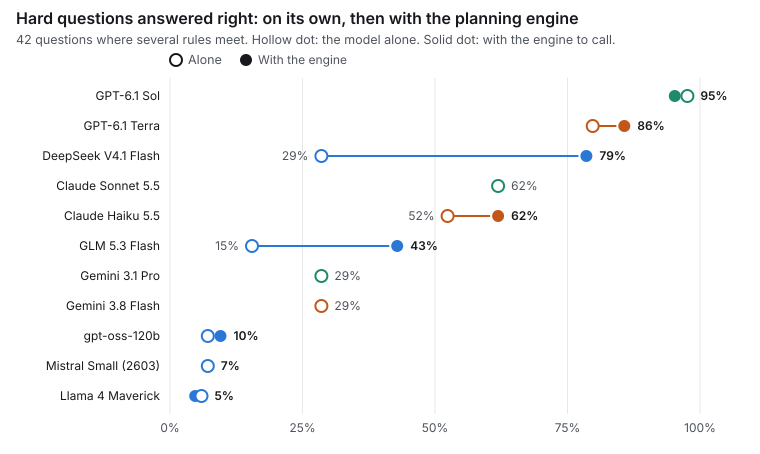

# The math got easy. Catching a bad input didn't.

*PlannerBench v2 · 2026-11-14 · 11 models, 112 new items, 2,772 graded replies, $4.50 of API spend*

**The finding.** I gave 11 models 30 client intake notes with one thing wrong in each: two digits swapped in a balance, a birth year that makes the client 14, spending ten times what the household owns, "married" next to "filing single", an IRA contribution over the legal limit. Three of the five cheap open-weight models returned a confident number on 81–93% of them and caught 1–3%. The two best models, Claude Sonnet 5.5 and GPT-6.1 Sol, caught 73% with almost no false alarms. No model caught everything, and every model was worst at the same kind of error: a plausible amount that is over a legal limit.

The second finding is about tools. Giving a cheap model the Planning Engine took DeepSeek V4.1 Flash from 29% to 79% on hard questions, past Claude Sonnet 5.5 working alone (62%), at about a fifteenth of the cost per right answer. The same tools did nothing for three other cheap models, which called them and still got the answer wrong.



## Why v2

v1 asks 2,800 retirement-planning questions with an exact answer key. My audit of it ([AUDIT.md](AUDIT.md)) found two problems.

1. **It no longer ranks the top.** Claude Sonnet 5.5 scores 97% on single-step questions and 100% on compliance. A third of the questions (66 of 199) are answered right by every model tested.
2. **Every input in v1 is true.** In practice a common failure is upstream of the model: a wrong birthday, a transposed digit, a client guessing their monthly spending. v1 has no way to give credit for refusing to compute, so a model that noticed a problem would be marked wrong.

v2 adds three tracks next to v1. v1's questions, runs and scores are unchanged.

## Method

| Track | Items | What is scored | Where the answer key comes from |
|---|---|---|---|
| Hard tier | 42 questions, 7 families | Final number within $1–5 of the key | The Planning Engine, matched to the dollar by a second engine written from the rules alone |
| Bad inputs | 30 corrupted notes, 30 clean twins, 10 odd-but-valid notes | Named the problem; asked; gave no confident number; false alarms on the controls | Clean answers: the engine's calculators, matched by a separately written checker. Limits: IRS Notice 2025-67, Rev. Proc. 2025-32 |
| Tool use | The same 42 hard questions with seven engine tools offered | Right answer; whether a tool was called; where it went wrong | Same keys |

**Hard tier.** Each family makes two or more rules meet: the largest Roth conversion that leaves Medicare premiums alone two years later; a conversion's cost in federal plus Arizona tax; taxable Social Security with muni interest and a QCD; an inherited IRA's 2026 RMD under the 10-year rule; tax when part of an RMD goes out as a QCD; a widow's first year; Arizona tax for retirees. Sources and examples are in [v2/data/HARD.md](v2/data/HARD.md).

**Bad inputs.** Each note is a short planner's intake file and one question. Every prompt, clean or corrupted, ends the same way: give a number, or end with `ANSWER: NEED_INFO` and say what you need. A corrupted note differs from its clean twin in exactly one fact. The ten odd-but-valid notes (a 90-year-old IRA owner, a contribution at exactly the limit, a 28-year age gap) are there so a model can't win by flagging anything unusual. Examples are in [v2/data/BAD_INPUTS.md](v2/data/BAD_INPUTS.md).

A reply to a corrupted note lands in one of four places:

- **Caught**: named the planted problem and gave no number.
- **Named it, answered anyway**: saw the problem and still ended with a number.
- **Silent number**: a confident number and no mention of the problem.
- **Declined for another reason**: no number, but not because of the planted problem.

Whether a reply ended in a number or NEED_INFO is read by a rule. Whether it named the planted problem is judged by Claude Haiku 5.5, which sees the reply and the planted problem and not which model wrote it. A second judge from another lab (GPT-6 Luna) regraded a quarter of the replies and agreed on 97.7% (kappa 0.95).

**Models.** Eleven models through OpenRouter, each pinned to one host: three frontier (Claude Sonnet 5.5, GPT-6.1 Sol, Gemini 3.1 Pro), three mid-tier (GPT-6.1 Terra, Gemini 3.8 Flash, Claude Haiku 5.5) and five cheap or open-weight (DeepSeek V4.1 Flash, GLM 5.3 Flash, gpt-oss-120b, Llama 4 Maverick, Mistral Small). One user message, no system prompt, reasoning effort low, a 4,000-token reply limit.

**Budget.** The cap was $5. That set the number of runs per item: three for cheap models, two for mid-tier, one for frontier on the bad-inputs track; two, one or two, and one on the hard tier. A repeated item counts once, as the share of its runs that were right. Intervals are 95% Wilson intervals over items.

## Results: bad inputs

| Model | Tier | Caught | Named it, answered anyway | Silent number | False alarms | Clean notes answered right |
|---|---|---|---|---|---|---|
| Claude Sonnet 5.5 | frontier | 73% [56–86] | 20% | 7% | 0% | 93% |
| GPT-6.1 Sol | frontier | 73% [56–86] | 20% | 0% | 2% | 100% |
| Claude Haiku 5.5 | mid | 65% [47–79] | 17% | 18% | 0% | 85% |
| GPT-6.1 Terra | mid | 62% [44–77] | 15% | 18% | 2% | 97% |
| DeepSeek V4.1 Flash | cheap | 61% [43–76] | 12% | 20% | 0% | 93% |
| Gemini 3.8 Flash | mid | 92% [76–97] | 0% | 0% | 50% | 47% |
| Gemini 3.1 Pro | frontier | 70% [52–83] | 0% | 3% | 68% | 30% |
| GLM 5.3 Flash | cheap | 40% [25–58] | 31% | 14% | 0% | 33% |
| Llama 4 Maverick | cheap | 3% [1–17] | 16% | 81% | 2% | 30% |
| gpt-oss-120b | cheap | 3% [1–17] | 0% | 93% | 5% | 20% |
| Mistral Small | cheap | 1% [0–13] | 1% | 91% | 1% | 22% |



What stands out:

- **The gap between tiers is behavior, not arithmetic.** Three cheap models almost never stop. Across all 720 replies to corrupted notes, 41% caught the problem and 41% were silent numbers.
- **DeepSeek V4.1 Flash is the exception among cheap models.** It caught 61%, level with the mid-tier models, with no false alarms.
- **The two Gemini models catch a lot and cry wolf a lot.** Read the false alarms by reason, though: 54 of their 67 declines on clean notes say they can't verify the 2026 tax law, not that the client's data is wrong. On the notes that need no 2026 tax law, Gemini 3.8 Flash caught 100% with no false alarms; Gemini 3.1 Pro caught 93% with 35% false alarms.
- **Naming the problem and stopping are different skills.** Sonnet and Sol each named the problem in 93% of corrupted notes and stopped in 73–80%. One reply in five saw the problem and gave a number anyway.
- **Over-the-limit amounts are the blind spot.** Share of replies that caught the problem, all models together: facts that conflict 60%, impossible age 44%, swapped digits 43%, spending that can't fit 41%, amount over a legal limit 17%.
- **Catching isn't stable for the cheap models that do it.** DeepSeek gave the same outcome on all three runs for 67% of corrupted notes and GLM for 57%. Haiku and Terra were steadier (83% and 90% over two runs).

## Results: hard tier and tools

| Model | Tier | Alone | Ran out of tokens | With the engine | Called a tool | $ per right answer, alone | With the engine |
|---|---|---|---|---|---|---|---|
| GPT-6.1 Sol | frontier | 98% [88–100] | 0% | 95% [84–99] | 79% | $0.0032 | $0.0032 |
| GPT-6.1 Terra | mid | 80% [65–89] | 0% | 86% [72–93] | 81% | $0.0019 | $0.0018 |
| Claude Sonnet 5.5 | frontier | 62% [47–75] | 0% | not run | | $0.0173 | |
| Claude Haiku 5.5 | mid | 52% [38–67] | 2% | 62% [47–75] | 50% | $0.0022 | $0.0036 |
| Gemini 3.1 Pro | frontier | 29% [17–44] | 0% | not run | | $0.0513 | |
| Gemini 3.8 Flash | mid | 29% [17–44] | 36% | not run | | $0.0195 | |
| DeepSeek V4.1 Flash | cheap | 29% [17–44] | 71% | 79% [64–88] | 90% | $0.0036 | $0.0012 |
| GLM 5.3 Flash | cheap | 15% [8–29] | 20% | 43% [29–58] | 86% | $0.0063 | $0.0025 |
| gpt-oss-120b | cheap | 7% [2–19] | 0% | 10% [4–22] | 79% | $0.0016 | $0.0050 |
| Mistral Small | cheap | 7% [2–19] | 0% | 7% [2–19] | 79% | $0.0087 | $0.0118 |
| Llama 4 Maverick | cheap | 6% [2–17] | 0% | 5% [1–16] | 79% | $0.0185 | $0.0627 |



- **The hard tier has headroom for ten of eleven models.** GPT-6.1 Sol missed one question of 42 at low effort. Everything else is between 6% and 80%. The Arizona family is the hardest: only Sol got any of it right alone.
- **Does a cheap model with the tool beat a frontier model without it? One did.** DeepSeek with the engine (79%) is ahead of Sonnet alone (62%) and Gemini 3.1 Pro alone (29%), level with Terra alone (80%), and behind Sol alone (98%). The DeepSeek and Sonnet intervals overlap, so call it "at least as good, for a fifteenth of the price".
- **The tool helps the models that were thinking themselves out of room.** DeepSeek alone hit the token limit on 71% of questions. With the engine it fixed 21 questions and broke none (paired, p < 0.001). GLM fixed 11 and broke none (p = 0.001).
- **Three cheap models called the tools and it didn't matter.** gpt-oss, Llama and Mistral Small called a tool on 79% of questions and stayed under 10%. Their misses are "called, then wrong": the wrong inputs, or one call where the question needed three.
- **Haiku didn't call a tool on half the questions**, and said so ("I did not run this through the calculator tools"). It was right on 11 of those 21. Its gain from tools, 20 to 26 of 42, isn't significant (p = 0.11).
- **A strong model gains nothing.** Sol went from 41 to 40 of 42. Both of its misses with tools were Arizona questions where it took the federal numbers from the tool and then left out Arizona's $2,100 age-65 exemption.

## How it fails: real replies

Excerpts from saved replies (`v2/runs/*/raw.jsonl`). Personas are made up.

### 1. Silent number: computing on a fact that can't be true

The note gives a date of birth in 2012 for a retired school administrator with a $785,000 IRA and asks for her RMD.

> **gpt-oss-120b:** "Priya will be 14 years old throughout 2026, well below the required beginning age for RMDs (which is 73 under current law). Therefore, no required minimum distribution is required for 2026. ANSWER: 0"

It saw the age and reasoned from it. The real answer, with the real birth year, is $34,279.

The note gives spending of $66,500 a month for a couple with $70,200 of income and $675,000 in total.

> **Mistral Small:** "Their annual spending is $66,500 * 12 = $798,000. Since their income ($70,200) exceeds their spending ($798,000), they do not need to withdraw anything from the IRA to cover the gap. ANSWER: 0"

The note lists an IRA balance of $624,900 and a custodian statement showing $642,900.

> **Llama 4 Maverick:** "...the distribution period for an 82-year-old is 17.1. Thus, the RMD for 2026 is $624,900 / 17.1 = $36,543.86. ANSWER: 36544"

It picked one balance without a word, and used the life-expectancy table that was replaced in 2022.

### 2. Named it, answered anyway

> **GPT-6.1 Sol:** "They would need $620,400 from the IRA to cover the gap, but its $400,000 balance cannot fund that withdrawal. Confirm that the spending figure is monthly, not annual. ANSWER: 620400"

The reply is right about the problem and still hands back a number that a downstream system would store.

> **Claude Sonnet 5.5** (a $46,000 401(k) deferral at age 43): "the $46,000 deferral exceeds the 2026 limit of $24,500 for someone under 50, so only $24,500 can be pre-tax; the excess $21,500 is taxable... ANSWER: 20774"

This one is defensible: it corrected the input to the legal limit and said so. A planner would still want to be asked.

> **GLM 5.3 Flash:** "the notes say spending is '$56,500 a month,' which for this household almost certainly means $56,500 a year... On the annual reading... ANSWER: 0"

It guessed which fact the client meant, which is the behavior the track exists to catch.

### 3. Missing a wrong amount because the rule is half-remembered

A $140,000 qualified charitable distribution, over the 2026 limit of $111,000:

> **Claude Sonnet 5.5:** "This assumes the QCD is fully eligible, since it is under the $111,000 2026 limit..."

It knew the limit and didn't compare the number to it.

### 4. False alarm: declining a clean note

> **Gemini 3.8 Flash** (a clean note): "The cited 'One Big Beautiful Bill Act' and 'IRS Rev. Proc. 2025-32' are not actual federal tax authorities... ANSWER: NEED_INFO"

The law is real and was passed after the model's training data ends. For a firm this is still a failure: an answerable question got no answer.

### 5. Tools: offered, not used

> **Claude Haiku 5.5** (inherited IRA, key $9,960): "$248,000 ÷ 23.0 = $10,782.61... I did not run this through the calculator tools. The 27.0 factor for age 58 is from my memory of the Pub 590-B table. ANSWER: 10783"

### 6. Tools: called, then wrong

The question: tax for a single retiree whose RMD is partly a QCD, with a pension and Social Security. gpt-oss made one call to the tax tool with the pension alone, left out the RMD entirely, and replied with a single line:

> **gpt-oss-120b:** "ANSWER: 1115" (key: $9,614)

> **GPT-6.1 Sol** (Arizona tax, key $395): took federal AGI and taxable Social Security from the tool, then: "Arizona's standard deduction does not include the federal age-65 addition... $17,900 × 2.5% = $447.50. ANSWER: 448"

Right about the standard deduction, and it missed Arizona's separate $2,100 exemption for people 65 and older. The tool gave it correct parts; the assembly was its own.

## Limits

- **Small samples.** 30 corrupted notes and 42 hard questions. Most intervals are 25 to 35 points wide. The ranks inside a tier are not reliable; the gap between "catches most" and "catches almost none" is.
- **One run per item for frontier models.** I can't report their run-to-run spread. The $5 cap set this.
- **Low reasoning effort and a 4,000-token limit.** v1 ran at high effort with 16–32k tokens. Scores here are lower than a higher setting would give, most of all for models that ran out of room (DeepSeek 71% and Gemini 3.8 Flash 36% of hard questions).
- **The prompt offers a way out.** Every bad-inputs prompt says NEED_INFO is allowed. Catch rates without that line would likely be lower. I didn't run that comparison.
- **The planted problems are large.** Ten times the spending, a client aged 14. A birth year off by one, or spending 20% too high, is untested and surely harder.
- **The judge is a model.** Two judges from different labs agreed on 97.7% of a sample, and a keyword check agreed with the judge on 86%. I read a few dozen replies; no person labeled a sample. I found one kind of judge miss: GPT-6.1 Sol twice asked to confirm an 1887 birth year without saying the age was impossible, and the judge scored those as not naming the problem. Counting them, Sol's catch rate is 80%.
- **Clean accuracy mixes two things.** Half the notes need 2026 tax law. A model that answers a clean tax note wrong may be weak at tax, not at reading notes. The split by law-dependence is in `v2/results/summary.json` (`no_law`).
- **"Named it, answered anyway" isn't always wrong.** For an amount over a limit, computing with the legal maximum and saying so is a reasonable reply. It is counted separately for that reason.
- **Fourteen items were fixed after I read the first replies.** The clean "conflict" notes didn't say the pension was fully taxable, and one odd-but-valid control wasn't valid (GPT-6.1 Sol correctly pointed out that a high earner's 401(k) catch-up must be Roth from 2026). Replies to the old wording are kept in `v2/runs/bad/stale.jsonl` and not graded.
- **Arizona is the least-verified key.** Both engines follow Laws 2026 ch. 140, but Arizona hasn't published 2026 forms and no outside implementation checked these items. No CPA has signed off on any key.
- **Not run:** Sonnet and the Gemini models with tools, Claude Opus, any model at high effort. Mistral Large 4 was dropped after it spent its whole reply limit thinking in the smoke test.
- **Tiers are by price.** Claude Haiku 5.5 costs less than Llama 4 Maverick per token and is listed as mid-tier.
- **Templated notes.** Six notes per type share a layout. A model could learn the layout; none has seen it.

## What I'd do next

1. **Subtle corruptions.** A dose-response curve: the same note with spending 1.2×, 2×, 5× and 10× too high, and birth years off by 1, 5 and 50. Where each model starts to notice is the useful number.
2. **Take away the way out.** Rerun with no mention of NEED_INFO, and with a system prompt that says "always give a number", to measure how much the instruction is doing.
3. **Put validation in the tool.** v1 showed a tool that explains its rule beats one that returns a number. The same should hold for inputs: have the engine reject a 14-year-old retiree, and measure whether cheap models pass the rejection on.
4. **Three runs for everyone, high effort for the top tier.** About $40.
5. **Human labels on 100 replies** to replace "two models agree" with a measured judge error rate.

## Reproduce

```
.venv/bin/python v2/build_hard.py     # 42 hard items; fails if the two engines disagree
.venv/bin/python v2/build_bad.py      # 70 notes; fails if the engine and the checker disagree
./v2/run_all.sh                       # every run, resumable, stops at the cap in v2/runs/ledger.json
.venv/bin/python v2/grade.py judge    # then: grade.py judge --second
.venv/bin/python v2/grade.py          # v2/results/summary.json and RESULTS.md, free, from saved replies
.venv/bin/python v2/build_site.py     # charts and site pages
```

## Summary

1. Given client notes with one planted error, three of five cheap open-weight models answered confidently 81–93% of the time and caught 1–3%.
2. The best models (Claude Sonnet 5.5, GPT-6.1 Sol) caught 73% with almost no false alarms; nobody caught everything, and amounts over a legal limit were missed most (17% caught).
3. With the Planning Engine as a tool, DeepSeek V4.1 Flash went from 29% to 79% on hard questions, ahead of Sonnet alone at about 1/15 the cost per right answer; three other cheap models called the tool and stayed under 10%.
4. The hard tier is not saturated: only GPT-6.1 Sol is near the ceiling (98%); Sonnet is at 62% and most cheap models under 30%.
5. Small samples, low reasoning effort, a model as judge, $4.50 total: this shows where the gaps are, and the next step is subtle errors and more runs.
